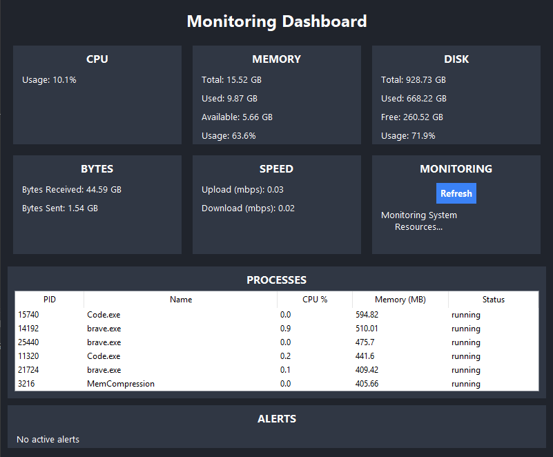

## PC Monitoring Dashboard

A desktop application built with Python and Tkinter to monitor system resource usage, network activity, running processes, and resource alerts.

## Features

- **CPU monitoring** — Displays current CPU utilization.
- **Memory monitoring** — Shows total, used, and available RAM, along with memory utilization.
- **Disk monitoring** — Shows total, used, and free disk space, along with disk utilization.
- **Network monitoring** — Tracks cumulative bytes sent and received and estimates upload and download speeds in Mbps.
- **Process monitoring** — Displays selected running-process information, including PID, name, CPU usage, memory usage, and status.
- **Process management** — Supports retrieving process details, sorting and searching process records, and guarded process termination through the process manager.
- **Resource alerts** — Reports high CPU, memory, or disk utilization when configured thresholds are exceeded.
- **Automatic updates** — Refreshes dashboard metrics periodically using Tkinter's `after()` method.

## Technologies

- Python
- Tkinter
- `psutil`

## Project Structure

```text
PC_Monitor/
├── main.py                 # Application entry point (if named differently, use your actual entry-point file)
├── dashboard.py            # Tkinter dashboard interface
├── system_monitor.py       # CPU, memory, and disk statistics
├── network_monitor.py      # Network traffic and throughput calculations
├── process_manager.py      # Running-process information and management
├── alert_manager.py        # CPU, memory, and disk threshold alerts
└── README.md
```

> Adjust the entry-point filename and project tree to match the files in your repository.

## Requirements

- Python 3.10 or newer recommended
- `psutil`

Tkinter is included with most standard Windows Python installations.

## Installation

1. Clone the repository:

   ```bash
   git clone https://github.com/maurice46/PC_Monitoring_Dashboard.git
   ```

2. Change to the project directory:

   ```bash
   cd PC_Monitoring_Dashboard
   ```

3. (Recommended) Create and activate a virtual environment.

   **Windows PowerShell:**

   ```powershell
   python -m venv .venv
   .\\.venv\\Scripts\\Activate.ps1
   ```

   **macOS/Linux:**

   ```bash
   python3 -m venv .venv
   source .venv/bin/activate
   ```

4. Install the dependency:

   ```bash
   python -m pip install psutil
   ```

## Running the Application

Run the Python file that creates the `Dashboard` and calls its `run()` method. If your entry point is `main.py`, use:

```bash
python main.py
```

If you launch the dashboard directly from `dashboard.py`, make sure that file includes an entry point that instantiates `Dashboard` and calls `run()`.

## Alert Thresholds

The default thresholds in `AlertManager` are:

| Resource | Alert threshold |
|---|---:|
| CPU utilization | Above 85% |
| Memory utilization | Above 85% |
| Disk utilization | Above 90% |

These values can be changed when creating the `AlertManager`.

## How It Works

The application is organized into separate classes so each component has a focused responsibility:

- `SystemMonitor` collects CPU, memory, and disk statistics using `psutil`.
- `NetworkMonitor` reads network I/O counters and calculates transfer rates from changes between measurements.
- `ProcessManager` collects process information and provides sorting, searching, detail lookup, and guarded termination methods.
- `AlertManager` compares resource readings against configured thresholds and tracks active alerts.
- `Dashboard` presents the information in a Tkinter interface and schedules periodic updates.

## Notes and Limitations

- Network speeds are estimates calculated from changes in cumulative network counters over time.
- Process information may be unavailable for some processes because of operating-system permissions or because a process exits while being inspected.
- Terminating processes can cause applications to lose important information. Still thinking about implementing this one.
- The dashboard doesn't display all the processes.
- The application is intended as a local monitoring and learning project, NOT a replacement for a full system administration or observability platform.

## Future Improvements

Possible additions include:
- Process-table searching and sorting in the graphical interface.
- A confirmation dialog before terminating a process.
- Historical usage graphs.
- Configurable alert thresholds through the interface.
- Automated tests for monitoring and process-management behavior.

## Screenshot


